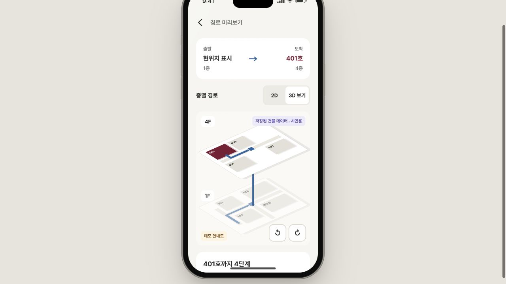
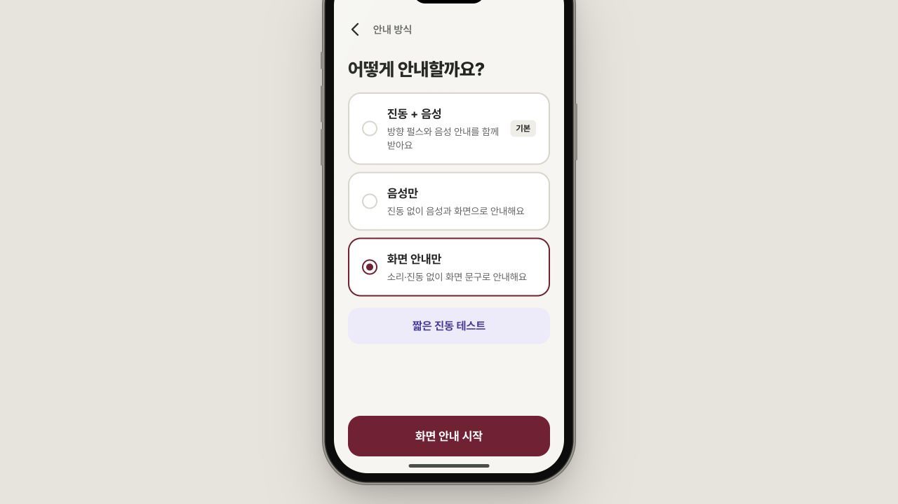
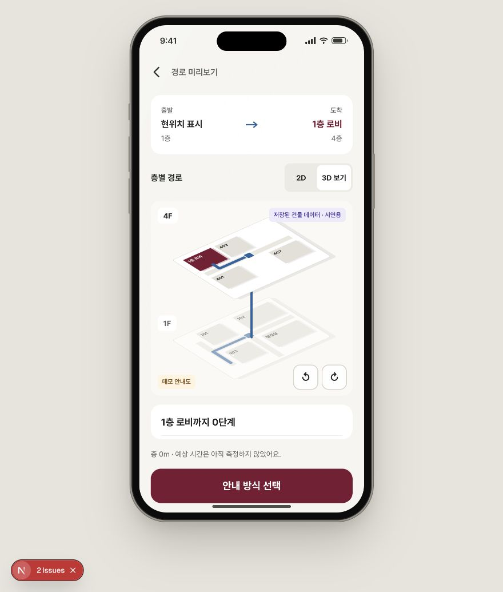

# Main branch bug check — 2026-10-31

Tested GitHub `origin/main` at **034000fddf59a4b1beabeb9c18227db16638d0cf** in a clean exported snapshot. The original working directory was five commits behind and contained local changes; those files, branch, existing servers on 3000/8000, and original database were preserved. No application source was changed and no GitHub issues were posted.

App: <http://127.0.0.1:3001/> · test backend: <http://127.0.0.1:8001/>.
The frontend uses **live API mode** against the isolated backend, with seeded SQLite data in `backend/database/bugcheck.sqlite`. Choosing the demo map bypasses image recognition only; search and route calculation below use Laravel.

## Confirmed findings

### 1. High: a second trip starts from the original lobby after arrival on 4F

Reproduced in both development and production builds.

1. Start → 우정정보관 → load the demo map → confirm the starting location.
2. Search for 405 and complete its four guidance steps, including the elevator.
3. On the arrival screen, choose **다른 목적지 찾기**.
4. Search for and choose 401.

**Actual:** the next route starts at the 1F lobby, travels by elevator to 4F, and takes four steps / 27 m. The user just arrived at 405 on 4F.

**Expected:** use the last confirmed destination (`4F-405`) as the new origin, or explicitly reconfirm location. The API can already return the correct one-step route `4F-405 → 4F-junc → 4F-401`.

**Cause:** `frontend/src/components/gilgyeol/ArrivalScreen.tsx:79` changes screens without updating location. `frontend/src/lib/gilgyeol/store.tsx:480` always derives the origin from the original `START_NODE_IDS` choice.

**Suggested fix:** store the current graph node separately from the initial location preset; update it on confirmed arrival and use it for subsequent routes.



### 2. Medium: choosing the current location produces a zero-step dead end

Reproduced in both development and production builds.

1. Start with the demo map's default 1F lobby location.
2. In destination search, choose **1층 로비**.
3. Continue to the guidance-mode screen and press Start.

**Actual:** the API correctly returns `total_m: 0`, `path: ["1F-lobby"]`, `steps: []`. The preview nevertheless labels the destination as 4F and draws a trip upstairs. Start then does nothing and leaves the user on the mode screen.

**Expected:** immediately report that the user is already at the destination, with the correct floor.

**Cause:** `frontend/src/lib/gilgyeol/useNavigation.ts:135` silently returns for empty steps. `frontend/src/components/gilgyeol/RoutePreviewScreen.tsx:54` defaults an absent final step to 4F. The primary CTA remains available.

**Suggested fix:** explicitly handle a valid zero-step route as arrival and derive endpoint floor metadata from the route endpoints rather than demo defaults.




### 3. Medium: a self-route bypasses draft-floor routing restrictions

Reproduced through the actual Laravel HTTP kernel; the test changes only the isolated database inside a rolled-back transaction.

1. Set 4F's status to `draft`.
2. Request `POST /api/route` with `{"start_node":"4F-405","dest_node":"4F-405"}`.

**Actual:** HTTP 200, empty steps, and an arrived destination on the unverified floor. A normal lobby-to-405 route under the same draft status is rejected with HTTP 422.

**Expected:** the draft-floor restriction also applies when start and destination are equal.

**Cause:** `backend/app/Services/RouteService.php` filters the edges by verified status, but does not validate endpoint floor status. Dijkstra immediately accepts an identical start and destination without visiting any edge.

**Suggested fix:** validate both endpoint floors before running pathfinding, including the zero-distance case.

### 4. Medium: missing vision configuration is reported as a bad photo

Reproduced through the HTTP kernel and the browser upload flow. The copied local configuration has no `OPENROUTER_API_KEY`; no external model call was made.

1. Leave `OPENROUTER_API_KEY` unset.
2. Upload a valid JPEG map.

**Actual:** HTTP 502 with `AI 인식에 실패했어요. 다시 찍어주세요`; the scanner asks the user to retake the photo. Retaking cannot fix a missing server credential.

**Expected:** distinguish unavailable server configuration from image-recognition failure and offer a useful fallback.

**Cause:** `VisionClient::json()` aborts with 503 for a missing key. `VisionController::vision()` catches the resulting HTTP exception through its `RuntimeException` catch and changes it to the generic 502.

**Suggested fix:** preserve HTTP exceptions/configuration errors while translating provider and JSON failures separately. This finding does not imply that keys belong in the browser.

### 5. Low: destination 401 appears twice and triggers duplicate React keys

Reproduced visually in production and in development console logs.

1. Choose 401 as a destination on the 1F-to-4F route.
2. Inspect the default 3D route preview.

**Actual:** two rooms show `401`. The development console logs `Encountered two children with the same key, 401`.

**Cause:** `frontend/src/components/gilgyeol/IsoFloor.tsx:50` renames a fixed room to the destination while line 52 still includes a room named 401. `IsoPlane` uses room labels as React keys at line 86.

**Suggested fix:** use stable room IDs and highlight the existing destination, rather than relabeling another room.

## Verification results

| Check | Result |
| --- | --- |
| `php artisan test` | 19 tests passed, 93 assertions |
| `node --test src/lib/gilgyeol/navMath.test.mjs` | 5 tests passed |
| `python3 ai/eval/matcher.py` | 22 expected canonicalization/matching cases passed |
| `npm run lint` | Passed |
| TypeScript after Next generated route types | Passed |
| `npm run build` with a fresh cache | Passed; all seven static pages generated |
| Production browser flow: demo map → confirm start → live search → route → instructions → arrival | Passed for lobby → 405 |
| Second-trip and zero-step cases | Bugs 1 and 2 reproduced in production |
| Bad node, missing search term, missing photo | Rejected with 422 |
| Graph save without admin token | Rejected with 401 |
| Draft destination on a normal route | Rejected with 422 |
| Draft self-route | Incorrectly accepted; bug 3 |

The first build attempt failed because the sandbox blocked a Turbopack worker port. A fresh build outside that restriction passed. A TypeScript invocation before Next generated its route types initially reported missing `LayoutProps`; this cleared after generation. Neither is counted as an application bug.

## Limits and next checks

- Live image-recognition accuracy and latency remain **untested** because the local backend has no OpenRouter vision key. The older Lablup pipeline on port 8765 is a separate workflow and is not part of this main snapshot.
- Physical camera, phone orientation, haptics, and on-site direction accuracy require device testing. Camera/sensor permissions were not granted during this desktop check.
- Code-review concern: the start screen still labels choices as 1F, and route selection uses static 1F preset IDs even when a parsed map is on another floor. Verify a real 4F upload once vision is configured; this is not presented as a completed live recognition test.
- The 1F-to-4F diagrams are fixed demo drawings, while instructions come from the actual route. Check visual direction consistency against verified geometry before using them for real navigation.

## Re-run the API probes

From the snapshot's `backend` directory:

```bash
DB_CONNECTION=sqlite \
DB_DATABASE=/Users/myeongseong/Documents/IntThon/main-bugcheck-20261031/backend/database/bugcheck.sqlite \
DB_URL= CACHE_STORE=array SESSION_DRIVER=array \
php ../bug-report/api-probes.php
```

The optional missing-key photo check uses the originally supplied `/Users/myeongseong/Downloads/IMG_4965 Medium.jpeg`. Other developers can replace that path with any valid local JPEG. Probe output is saved in `api-probes.jsonl`; it excludes debug stack traces. The draft-floor checks always roll back their transaction.
